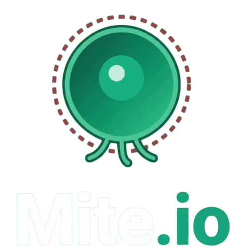

# Mite.io 🧫🧬🎮 — Evolution action inside the bloodstream



[](https://mite-io.pages.dev/)
[](https://github.com/MeowDev1011/Mite.io/blob/main/LICENSE)
[](https://github.com/MeowDev1011/Mite.io)
[](https://github.com/MeowDev1011/Mite.io)
[](https://www.typescriptlang.org/)
[](https://vitejs.dev/)

Mite.io is a fast, chaotic browser survival game where you play as a microbe inside the bloodstream. 🦠⚡
Grow by absorbing cells, split to attack or escape, avoid antibodies, evolve with mutations, and dominate the arena. 🧬🔥

Play now: https://mite-io.pages.dev/ 🚀

---

## Table of contents 📚
- 🧠 What this is
- ✨ Features
- 🎮 How to play
- 🕹️ Controls
- ⚙️ Core systems
- 🧱 Repo structure
- 🛠️ Local setup
- 🤝 Contributing
- 🐞 Troubleshooting
- 🔗 Links

---

## What this is 🧠
Mite.io is a browser based action game with evolution and survival mechanics. 🧫
You start small, absorb nearby cells and grow into a more dangerous organism. 🥚➡️🦠
The gameplay loop is simple but intense: eat, grow, split, dodge, attack, mutate, survive. 🎯
The project is built with TypeScript, React and Vite and it uses a canvas driven game loop for fast input and smooth simulation. ⚡🎨

---

## Features ✨
- 🧬 Mutation system with mid match evolution choices
- ✂️ Split mechanic to attack, evade or reposition
- 💨 Eject mass to create projectiles and tactical pressure
- 🤖 AI bots with different behaviors and aggression patterns
- 🏆 Achievement tracking and unlock notifications
- 🛍️ In game store with cytes and cosmetic skins
- 🎨 Skin selection and visual customization
- 💾 Local profile persistence for progression and settings
- 🌍 Internationalization and language detection
- 📱 Mobile friendly controls and responsive HUD
- 🔊 Sound engine with mute and volume support
- 🧰 Optimized rendering and simulation for browser performance

---

## How to play 🎮
- 🧪 Spawn into the arena and begin absorbing small cells
- 🧠 Grow carefully while avoiding larger threats
- ✂️ Split into smaller bodies to trap or escape predators
- 💣 Use eject mass to pressure enemies or create distance
- 🧬 Take mutation choices to specialize your build
- 🏁 Survive longer and dominate the map

---

## Controls 🕹️
- 🖱️ Aim: mouse
- ✂️ Split: Spacebar
- 💨 Eject mass: W
- ⏸️ Pause: Escape
- 📱 Mobile: touch steering and virtual controls

---

## Core systems ⚙️
### Growth and survival
- 📈 Larger organisms usually move more slowly due to mass
- 🍽️ Smaller cells are easier to absorb
- ⚠️ Bigger enemies are dangerous but provide higher reward when defeated

### Split behavior
- ✂️ Splitting divides your mass across multiple bodies
- 🔁 Recombining restores mass when split pieces return close to each other after a cooldown period
- 🧠 Use split to attack, kite, and control space on the map

### Eject and projectiles
- 💨 Eject removes a small amount of player mass and spawns a projectile entity
- 💥 Projectiles apply push or damage based on configured projectile mass and damage multiplier

### Mutation system
- 🧬 Mutations are offered during a match at milestone events
- 🔀 Mutations modify stats like speed, regen and eject power and can enable new behaviors
- 📊 Rules for stacking and interactions live in src/game/constants.ts and should be tested when changed

---

## Repo structure 🧱
```bash
package.json
index.html
vite.config.ts
tsconfig.json
env.example
README.md
AGENTS.md
DEV.md
LICENSE
mite_io_logo.png
src/
  App.tsx
  main.tsx
  index.css
  game/
    engine.ts
    physics.ts
    types.ts
    constants.ts
    skins.ts
    bacteria.ts
    achievements.ts
    botNames.ts
  components/
    TitleScreen.tsx
    GameHUD.tsx
    GameOverModal.tsx
    PauseModal.tsx
    EvolutionModal.tsx
    ShopModal.tsx
    SkinsModal.tsx
    TutorialModal.tsx
    AchievementsModal.tsx
    AchievementToast.tsx
  audio/
    soundEngine.ts
  storage/
    profileStorage.ts
  i18n/
    languages.ts
```

---

## Local setup 🛠️
Requirements:
- 🟢 Node.js 18 or newer
- 📦 npm, pnpm, or yarn

Install and run:
```bash
git clone https://github.com/MeowDev1011/Mite.io.git
cd Mite.io
npm install
cp .env.example .env
npm run dev
```

Production build:
```bash
npm run build
npm run preview
```

Useful scripts:
```bash
npm run dev
npm run build
npm run preview
npm run lint
```

---

## Development guide 👩‍💻
The detailed engineering guide lives in DEV.md. 🧰
It includes setup, architecture, coding conventions, testing strategy and CI examples. 🚀

Agent integration information lives in AGENTS.md. 🤖

---

## Contributing 🤝
Contributions are welcome. ✨
Open issues for bugs, balance suggestions, gameplay ideas, or UI improvements. 🐞
Keep changes scoped, readable and easy to review. 👀

Recommended workflow:
```bash
git checkout -b feature/my-change
npm run lint
npm run build
```

Before opening a PR:
- ✅ Run lint
- ✅ Build the project
- ✅ Test the behavior manually
- ✅ Keep the patch focused

---

## Troubleshooting 🐞
- 🎧 Audio on mobile may require a user interaction before playback
- 🧭 Canvas blank issues: open DevTools and inspect console errors and verify the root mount in index.html
- 💾 Profile persistence issues: check localStorage permissions in your browser

---

## Links 🔗
- 🌐 Demo: https://mite-io.pages.dev/
- 🐱 GitHub: https://github.com/MeowDev1011/Mite.io
- 🧰 Developer guide: https://github.com/MeowDev1011/Mite.io/blob/main/DEV.md
- 🤖 Agent guide: https://github.com/MeowDev1011/Mite.io/blob/main/AGENTS.md
- 📜 License: https://github.com/MeowDev1011/Mite.io/blob/main/LICENSE

---

Mite.io is small, fast and chaotic in the best possible way. 🧫⚡🎉
If you enjoy the project, give it a star and help it grow. ⭐ :D
